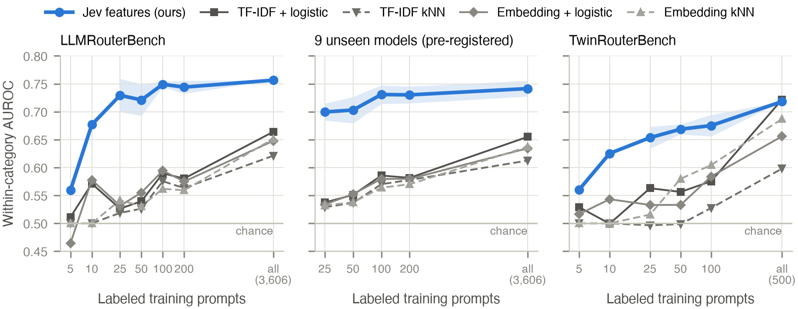
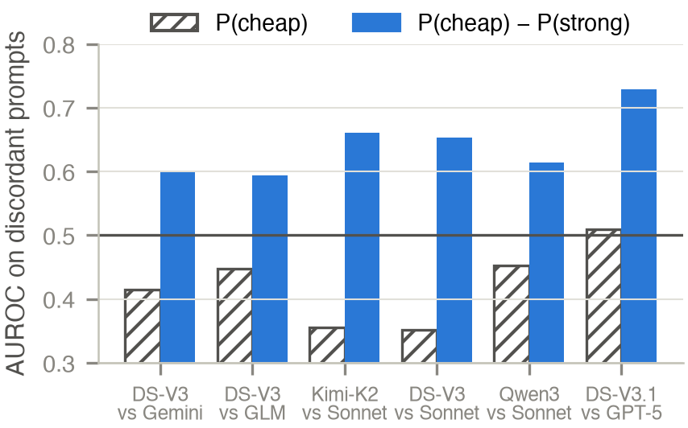
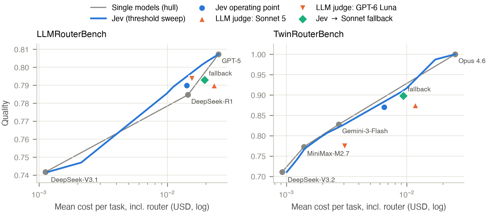
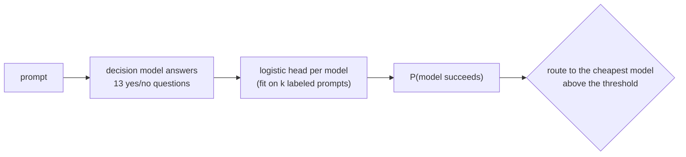

<div align="center">

# Predicting LLM Success Is Not Enough for Routing

**Few-label question features learn *difficulty*, not *complementarity***

Dante de Prenda · Columbia University

[](https://github.com/dantedeprenda/routing-success-prediction/actions/workflows/tests.yml)


[**Paper (arXiv)**](#citation) · [**Results**](#results) · [**Quick start**](#quick-start) · [**Reproduce**](#reproduce-the-paper) · [**Pre-registrations**](preregistration/)

</div>

---

To route a request to the cheapest LLM that can still answer it, you need a per-request guess of
whether that model will succeed. This repository holds the code, frozen inputs, pre-registrations
and evidence tables behind the paper's two findings:

> **1. Success prediction needs very few labels.** Thirteen yes/no questions, answered by a small
> decision model and fed to a logistic head, predict success from **25 labeled prompts** better
> than text routers trained on **all 3,606**.
>
> **2. Better success prediction does not buy better routing.** The predictors learn which prompts
> are *hard*, and hard prompts are hard for every model. Where the two models actually disagree, the
> predictors rank the cases **backwards**.

<p align="center">
  
</p>
<p align="center"><sub>Within-category AUROC for predicting whether a cheap model succeeds, against the number of labeled prompts. Bands: ±1 sd over five label seeds (middle panel: over the nine unseen target models). Points at k = 5 and 10 are exploratory means.</sub></p>

## Results

### Finding 1: 25 labels are enough to predict success

On LLMRouterBench, question features with 25 labels reach a within-category AUROC of **0.729**. The
best text router trained on every label reaches **0.664**. The advantage holds up under three
pre-registered stress tests:

| Test | k = 25, gain over best text router | |
|---|---|---|
| 9 target models never used in the design | **+0.167** [+0.136, +0.197] | pre-registered |
| Held-out domains + 25 local labels | **+0.195** [+0.137, +0.252] | pre-registered |
| Questions written by an LLM that saw no data | **+0.130** [+0.080, +0.177] | pre-registered |

The label-blind questions keep about two thirds of the advantage (0.058 AUROC below the author's
questions).

### Finding 2: better prediction does not mean better routing

<table>
<tr>
<td width="55%">

- **No router beats always using the mid-priced model at equal cost.** That includes ours, the
  text routers and a frontier LLM router.
- **A pre-registered second model pair with twice the headroom fails too:** −0.010
  [−0.032, +0.010] against the best single model.
- **On prompts where exactly one model is right**, success heads score an AUROC of **0.422**
  [0.360, 0.487] over six pre-registered pairs. They rank those prompts backwards.
- **Routing on the *difference*** P(cheap) − P(strong) repairs the ranking: **+0.018** [+0.009,
  +0.028] routing quality over P(cheap) alone, reaching parity with the best single model. The
  difference signal needs far more labels than success prediction does.

</td>
<td width="45%">

</td>
</tr>
</table>

### Against a frontier LLM router

As a router, the decision model matches a Claude Sonnet 5 router's quality on both benchmarks. It
costs **39–45% less** and is about **8× faster** (p50 0.3 s vs 2.3–2.8 s).

<p align="center">
  
</p>

Every number above links to a table in [`results/evidence/`](results/evidence/) or
[`results/judge_sample/`](results/judge_sample/). Negative results are reported with the same
detail as positive ones.

| Result | Table |
|---|---|
| 25 labels vs all 3,606 | [`llmrouterbench_test.md`](results/evidence/llmrouterbench_test.md) |
| Unseen target models | [`extensions_T.md`](results/evidence/extensions_T.md) |
| Held-out domains | [`extensions_D.md`](results/evidence/extensions_D.md) |
| Label-blind questions | [`blind_questions.md`](results/evidence/blind_questions.md) |
| Second model pair | [`second_pool.md`](results/evidence/second_pool.md) |
| Difficulty vs complementarity | [`complementarity.md`](results/evidence/complementarity.md) |
| LLM-router comparison | [`judge_sample/`](results/judge_sample/) |
| Small budgets (k = 5, 10) and deferral, exploratory | [`small_budgets.md`](results/evidence/small_budgets.md) |

## How it works



1. **One format for every benchmark.** Loaders (`src/dmroute/data/`) turn each benchmark into an
   ordered model pool, cheapest to strongest. Each prompt carries router-visible text plus every
   model's recorded quality and cost.
2. **One request per prompt.** A decision model answers all 13 questions in a single call
   (`src/dmroute/questions.py`). A logistic head per model maps the answers to P(success).
3. **Offline evaluation.** Every external call is cached, so threshold sweeps, bootstraps and
   label-budget curves run without new API calls.
4. **No test leakage.** Thresholds are chosen on the labeled prompts only and applied unchanged to
   a fixed test split. Prompts seen while designing the questions are excluded from the test split.

<details>
<summary><b>The 13 questions</b></summary>

Each is asked about *the next assistant response in this conversation*: the reply the routed model
would write.

| Feature | Question |
|---|---|
| `multistep` | Does writing it correctly require a multi-step chain of reasoning, beyond recall or a single transformation? |
| `math` | Does it require non-trivial mathematical calculation or proof? |
| `code` | Does it require writing, modifying, or debugging code? |
| `expert` | Does it require specialist, expert-level knowledge (e.g. graduate-level science, law, or medicine)? |
| `obscure_fact` | Does a correct response depend on recalling an obscure or long-tail fact? |
| `long_context` | Does it depend on details spread across a long conversation or document? |
| `state_tracking` | Does it depend on exactly tracking results of earlier tool calls or turns? |
| `error_recovery` | Must it recover from an earlier error, failed test, or wrong assumption? |
| `strict_format` | Does it demand an exact output format or precise constraints that are easy to violate? |
| `agent_action` | Is it a tool call or other action inside an agentic workflow? |
| `routine_tool_use` | Is it one or more straightforward tool calls whose arguments are stated plainly? |
| `ambiguous` | Is the request behind it ambiguous or open-ended, so a good answer requires judgment? |
| `trivial` | Could almost any language model write it correctly? |

The exact wording is in [`src/dmroute/questions.py`](src/dmroute/questions.py). The label-blind and
pair-aware sets are in [`configs/questions/`](configs/questions/).

</details>

## Quick start

No API keys, about a minute. Needs [uv](https://docs.astral.sh/uv/).

```bash
git clone https://github.com/dantedeprenda/routing-success-prediction.git
cd routing-success-prediction
uv sync --extra dev
uv run pytest                                  # unit + end-to-end tests on synthetic data
uv run dmroute run configs/synthetic.yaml      # full pipeline with stub models -> results/synthetic/
```

The Python package is called `dmroute`.

## Reproduce the paper

| Without API keys | With API keys |
|---|---|
| Tests and the synthetic pipeline | Every table and figure from scratch |
| Figures, from the saved tables in `results/` | Question answers from Jev (`TYPESAFE_API_KEY`) |
| The headroom scan (needs the LLMRouterBench download) | LLM-router baselines and question generation (`OPENROUTER_API_KEY`, `ANTHROPIC_API_KEY`) |

A full rerun with keys costs under $20, mostly for the LLM-router baselines. Every call is cached,
so reruns are free.

```bash
cp .env.example .env                           # add the keys you have
uv sync --extra dev --extra embeddings --extra laya
uv run dmroute fetch llmrouterbench && uv run dmroute fetch twinrouterbench

uv run dmroute run configs/llmrouterbench_test.yaml          # main runs, 5 label seeds
uv run dmroute run configs/twinrouterbench_test.yaml
uv run python scripts/evidence.py configs/llmrouterbench_test.yaml   # significance, leave-one-out
uv run python scripts/extensions.py T                       # pre-registered: unseen models
uv run python scripts/extensions.py D                       # pre-registered: held-out domains
uv run python scripts/extensions.py E                       # explanation ablations
uv run python scripts/blind_questions.py answer && uv run python scripts/blind_questions.py analyze
uv run python scripts/second_pool.py                        # pre-registered: second model pair
uv run python scripts/complementarity.py answer && uv run python scripts/complementarity.py analyze
uv run python scripts/small_budgets.py                      # exploratory: k = 5, 10 and deferral
uv run python scripts/figures.py                            # paper/figures/
```

The LLM-router comparison has its own command lines in the docstring of `scripts/judge_sample.py`.
The Laya baseline can run on a free Kaggle GPU; see [`kaggle/README.md`](kaggle/README.md).

## Pre-registration

Three sets of experiments were written down and pushed to GitHub **before** their outcomes were
computed. Anything not covered by a pre-registration is labeled *exploratory*.

| Pre-registration | What it froze |
|---|---|
| [`v1`](preregistration/v1.md) | transfer to 9 unseen models and held-out domains; explanation ablations |
| [`v2`](preregistration/v2.md) | label-blind question sets; a second model pair |
| [`v3`](preregistration/v3.md) | difficulty vs complementarity on six model pairs; pair-aware questions |

[`preregistration/README.md`](preregistration/README.md) lists the commit ids and GitHub receive
times that date them.

## Repository layout

```
src/dmroute/           loaders, routers, backends, metrics, policies, CLI
configs/               experiment configs; configs/questions/ holds the label-blind and pair-aware sets
scripts/               one script per analysis in the paper
results/evidence/      evidence tables behind every reported number (Markdown + JSON)
results/judge_sample/  LLM-router comparison
preregistration/       the three pre-registrations, verbatim
paper/figures/         figures (PNG + PDF)
kaggle/                optional: run the Laya baseline on a Kaggle GPU
tests/                 synthetic and fixture-based tests
```

## Data, models and terms

| Resource | License / terms | In this repository |
|---|---|---|
| [LLMRouterBench](https://huggingface.co/datasets/NPULH/LLMRouterBench) | MIT | downloaded by `dmroute fetch`, not included |
| [TwinRouterBench](https://huggingface.co/datasets/Amorph/TwinRouterBench) | Apache-2.0 | downloaded by `dmroute fetch`, not included |
| TypeSafe Jev (`jev-1.13.0`) | [Master Customer Agreement](https://typesafe.ai/legal/mca) | derived results only |
| Convai Laya | Apache-2.0 | run locally |
| Question sets | MIT (this repository) | `src/dmroute/questions.py`, `configs/questions/` |

**Raw Jev answers are not redistributed.** TypeSafe's terms restrict uses of its outputs that could
facilitate model distillation, so only derived results are included.

**Disclosure.** The author has no affiliation with TypeSafe or Convai and received no compensation
or free access from either. AI coding assistants were used during development; the paper states
their use and scope.

## Citation

<!-- RELEASE: add the arXiv id and BibTeX once the preprint is live. -->
The paper is forthcoming on arXiv. Until then, please cite this repository
([`CITATION.cff`](CITATION.cff)):

```bibtex
@misc{deprenda2026routing,
  title  = {Predicting {LLM} Success Is Not Enough for Routing: Few-Label Question Features
            Learn Difficulty, Not Complementarity},
  author = {de Prenda, Dante},
  year   = {2026},
  note   = {Code: https://github.com/dantedeprenda/routing-success-prediction}
}
```

## License

Code: [MIT](LICENSE). Benchmarks and models keep their own licenses (see the table above).
